# Lab 03: WordPress SAML Single Sign-On with Authentik

  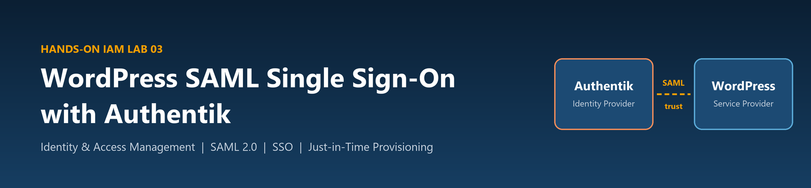

  <strong>Professional Lab Documentation | Identity & Access Management / Cybersecurity</strong>

  
  
  
  
  

---

## Table of Contents

1. [Project Overview](#project-overview)
2. [Objectives](#objectives)
3. [Scenario / Business Context](#scenario-business-context)
4. [Technologies & Tools](#technologies-tools)
5. [Architecture / Workflow](#architecture-workflow)
6. [Implementation / Steps Performed](#implementation-steps)
7. [Key Findings / Results](#key-findings-results)
8. [Skills Demonstrated](#skills-demonstrated)
9. [Screenshots & Evidence](#screenshots-evidence)
10. [Real-World Relevance](#real-world-relevance)
11. [Summary](#summary)
12. [Disclaimer](#disclaimer)

---

## :pushpin: Project Overview

This lab configures **SAML 2.0 Single Sign-On (SSO)** between **Authentik**, acting as the **Identity Provider (IdP)**, and **WordPress**, acting as the **Service Provider (SP)**.

When every application keeps its own usernames and passwords, users juggle many credentials and administrators lose a single point of control over who can sign in where. SSO moves authentication to one trusted identity provider. In this lab, a user signs in to Authentik once, clicks the WordPress tile, and arrives in WordPress already signed in. WordPress creates the account automatically on first login through **just-in-time (JIT) provisioning**.

**Main objective:** establish a signed SAML trust between an IdP and an SP, restrict the application to approved users, and validate the end-to-end sign-in as a standard (non-admin) user.

> **Evidence scope.** This documentation is based on the training guide *Hands-On IAM Labs – Lab 3: Setting Up Single Sign-On* by **Andrew, All Things Identity** (guide version V14). All screenshots are the guide author's example screenshots, captured on Authentik 2026.8.5 in November 2026, and are attributed to All Things Identity. They illustrate the expected configuration and results; they are not independent evidence of hands-on completion by the portfolio owner. Results below are therefore described as **source-demonstrated** or **expected**.

### Lab Environment (from the source guide)

| Component | Details |
|---|---|
| Identity Provider | Authentik (screens captured on 2026.8.5) |
| Service Provider | WordPress |
| SAML SP plugin | miniOrange *SAML Single Sign On – SSO Login*, free tier (v6.2.0 when the guide was checked) |
| Transport | Plain HTTP by design (lab only) |
| WordPress admin | `http://SERVER_IP:WP_PORT/wp-admin` |
| Authentik admin | `http://SERVER_IP:AUTHENTIK_PORT/if/admin/` |
| Authentik user portal | `http://SERVER_IP:AUTHENTIK_PORT/if/user/` |
| Example test user | `wp.tester` / `wp.tester@example.com` |

`SERVER_IP`, `WP_PORT` and `AUTHENTIK_PORT` are placeholders for the values issued with each lab environment.

---

## :dart: Objectives

The guide's stated learning objectives are to:

- Configure SAML SSO between Authentik and WordPress
- See just-in-time (JIT) provisioning create a WordPress account on first login
- Test SSO with a non-admin test user
- Explain the difference between SAML and OIDC

Supporting tasks in the guide include exchanging SAML metadata to establish trust and limiting access to WordPress with an Authentik user binding.

---

## :office: Scenario / Business Context

The source guide does not describe a specific organization. It frames the lab around a common identity pattern: an application should trust a central identity provider instead of managing its own passwords.

The design goals set out in the guide are:

- **One sign-in:** the user authenticates once at Authentik and opens WordPress from a portal tile.
- **No manual account creation:** WordPress creates the account on first login (JIT provisioning).
- **Controlled access:** a policy, group or user binding decides who can open WordPress.
- **Existing controls stay in force:** MFA configured in Lab 2 still applies during the SSO sign-in.

**Prerequisites listed in the guide:** Lab 0 complete (all lab services reachable), Lab 2 complete (Authentik admin access confirmed), WordPress installed with a working admin login, at least one test user in Authentik, and a high-level understanding of SAML and OIDC.

---

## :hammer_and_wrench: Technologies & Tools

| Technology / Tool | Purpose in this lab |
|---|---|
| **Authentik** | Identity Provider: authenticates the user, enforces MFA, applies access bindings and issues signed SAML assertions |
| **WordPress** | Service Provider: the target application that trusts Authentik's assertions |
| **miniOrange SAML Single Sign On – SSO Login** | WordPress plugin that adds SAML Service Provider capability (free tier) |
| **SAML 2.0 (HTTP-POST binding)** | Federation protocol that carries the user's identity in a signed XML assertion through the browser |
| **X.509 signing certificate** | Authentik signs assertions; WordPress verifies the signature with the certificate from the IdP metadata |
| **TOTP MFA** | Second factor configured in Lab 2 and still enforced at the Authentik sign-in |
| **Browser developer tools** | Used to read the real API error behind a failed form submission |

### SAML vs OIDC (simplified comparison)

A simplified comparison adapted from the guide's quick reference, with terminology clarified.

| | SAML 2.0 | OIDC |
|---|---|---|
| Format | XML | JSON |
| Best for | Enterprise web apps | Modern apps, APIs, mobile |
| Complexity | Higher | Lower |
| Used in this lab | WordPress integration | Not used in this lab |

OIDC provides authentication on top of OAuth 2.0 and communicates identity using an ID Token represented as a JSON Web Token (JWT). OIDC is covered here for comparison only; it is not implemented in this lab.

---

## :building_construction: Architecture / Workflow

Both diagrams below are written in Mermaid inside this README, so GitHub draws them directly. To change a label, box or arrow, edit the text in the `mermaid` code block.

### Architecture

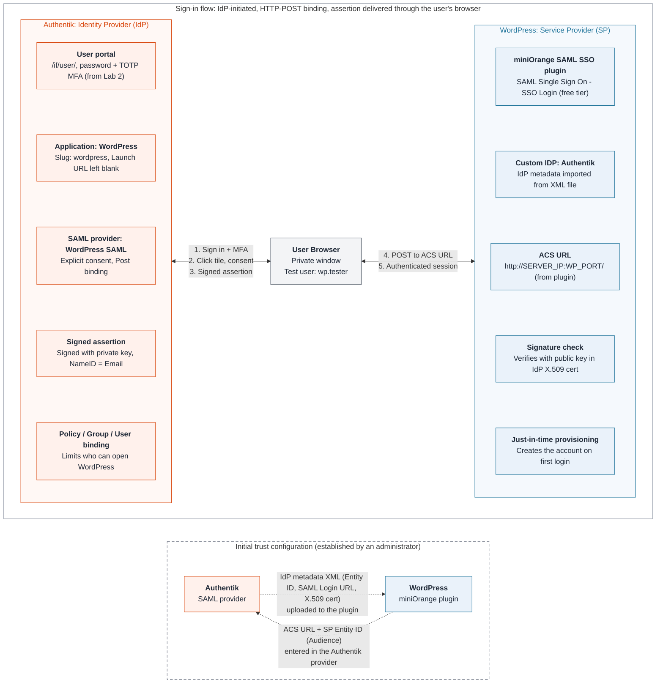

Authentik owns authentication; WordPress trusts Authentik's signed assertions. The initial trust configuration is established by an administrator through the following exchange:

- WordPress's **ACS URL** and **SP Entity ID** are entered into the Authentik SAML provider.
- Authentik's **IdP metadata** (Entity ID, SAML login URL and X.509 signing certificate) is uploaded into the WordPress plugin.

At sign-in, the sign-on starts from the IdP (the user clicks the WordPress tile in the Authentik portal), and the signed assertion travels **through the user's browser** to WordPress using the HTTP-POST binding.

The numbered labels on the diagram correspond to:

1. The test user signs in to the Authentik user portal (password + TOTP).
2. The user clicks the WordPress tile and approves the explicit-consent screen.
3. Authentik returns a signed SAML assertion to the browser.
4. The browser POSTs the assertion to the WordPress ACS URL.
5. WordPress validates it, creates the account if new (JIT), and starts a session.

The lab uses plain HTTP for transport; production deployments use HTTPS.

### Configuration and Validation Workflow

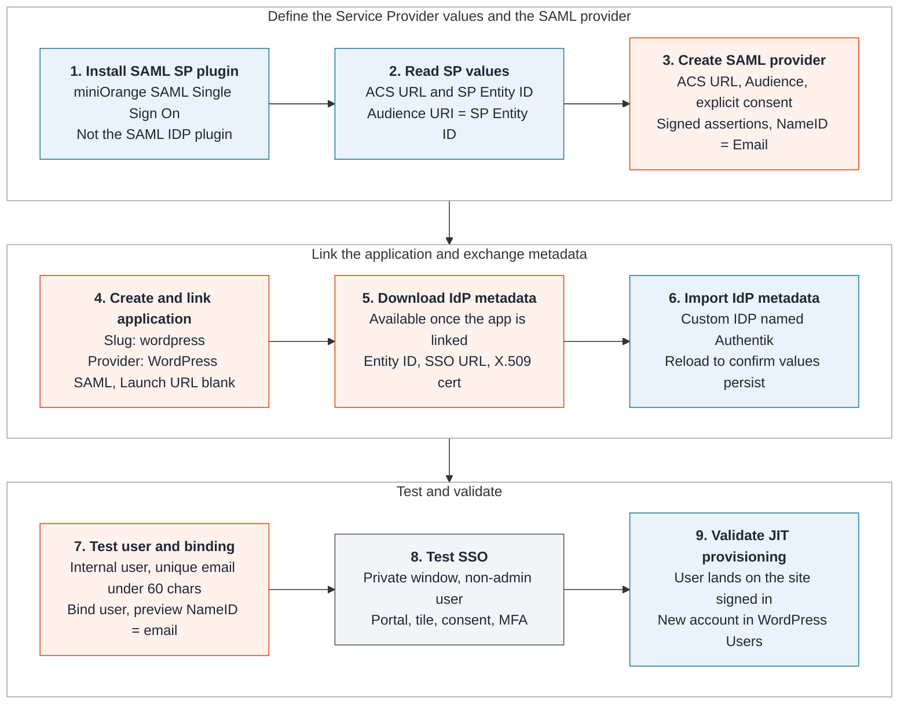

The order matters in both directions. The plugin is installed first because it defines the ACS URL and Entity ID, which differ between plugin versions. The Authentik application is created before the metadata is downloaded, because Authentik generates the metadata from the application slug and has none until the application exists.

### SAML Identifier Reference

These values are easy to confuse. The table shows which system defines each one and where it is used.

| Value | Defined by | Used in | Example format in the guide (plugin v6.2.0) |
|---|---|---|---|
| **ACS URL** (Assertion Consumer Service) | WordPress plugin | Authentik provider → *ACS URL* | `http://SERVER_IP:WP_PORT/` (site root with trailing slash) |
| **SP Entity ID / Issuer** | WordPress plugin | Authentik provider → *Audience* | `http://SERVER_IP:WP_PORT/wp-content/plugins/miniorange-saml-20-single-sign-on/` |
| **Audience URI** | WordPress plugin | Same value as the SP Entity ID | Same as above |
| **IdP Entity ID / Issuer** | Authentik (generated from the application slug) | WordPress plugin → *IdP Entity ID or Issuer* | `http://SERVER_IP:AUTHENTIK_PORT/application/saml/wordpress/metadata/` |
| **SAML Login URL** (SAML endpoint) | Authentik (generated from the application slug) | WordPress plugin → *SAML Login URL* | `http://SERVER_IP:AUTHENTIK_PORT/application/saml/wordpress/` |

The SP values are **version-dependent**. The guide says to read them from the installed plugin instead of assuming the examples above. The Authentik **EntityID/Issuer override** field is left blank so that Authentik uses its generated IdP Entity ID.

---

## :gear: Implementation / Steps Performed

The steps below follow the source guide. Screenshots are the guide's example screens. Key screens are shown inline; supporting screens are in expandable sections under each step.

### Step 1: Install the WordPress SAML SP plugin

In WordPress admin (**Plugins > Add Plugin**), search for *miniOrange SSO using SAML 2.0*. The correct result is listed as **SAML Single Sign On – SSO Login** by miniOrange. The similarly named **SAML IDP (Identity Provider)** plugin from the same vendor is avoided: it turns WordPress into an identity provider, which is the reverse of this lab. The plugin is installed and activated on the free tier; the optional miniOrange account registration and the "Let's get started!" IdP pop-up can be dismissed.

<strong>Screenshot:</strong> choosing the correct SP plugin in WordPress search results

  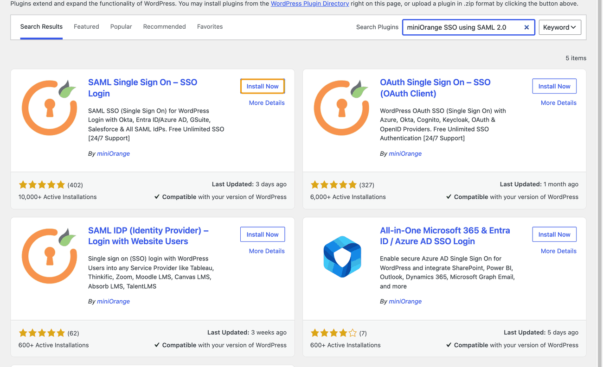
   <em>The correct SP plugin is the first result; the SAML IDP plugin further down does the reverse job. (Source: p. 5, Figure 3.2)</em>

### Step 2: Read the Service Provider values from the plugin

Under **miniOrange SAML 2.0 SSO > Plugin Configuration**, the **Service Provider Metadata** tab (a tab across the top of the page, not a left-menu item) shows the **SP-EntityID / Issuer**, the **ACS (AssertionConsumerService) URL** and the **Audience URI**. Both SP values are recorded exactly as shown, for use in Authentik.

  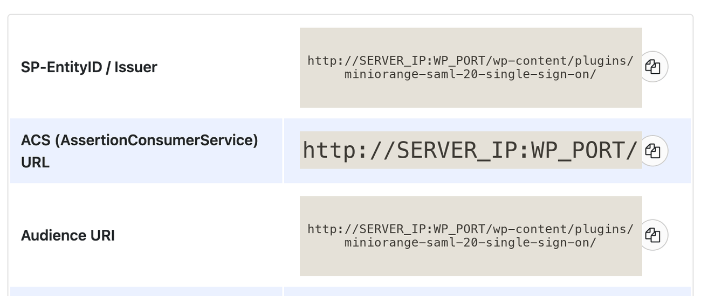
   <em>The ACS URL is the site root with a trailing slash; the Audience URI equals the SP Entity ID. (Source: p. 8, Figure 3.6)</em>

<strong>Screenshot:</strong> where to find the Service Provider Metadata tab

  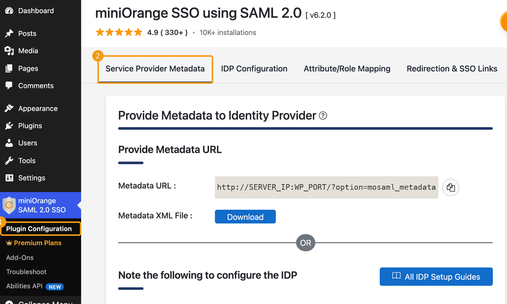
   <em>The SP values live on the Service Provider Metadata tab, not in the left menu. (Source: p. 8, Figure 3.5)</em>

### Step 3: Create the SAML provider in Authentik

In Authentik admin (**Applications > Providers > New Provider > SAML Provider**), the provider is created with these settings:

| Field | Value |
|---|---|
| Name | `WordPress SAML` |
| Authorization flow | `default-provider-authorization-explicit-consent` |
| ACS URL | The ACS URL from Step 2 |
| Audience | The SP Entity ID from Step 2 |
| EntityID/Issuer override | Left blank (Authentik generates its own Entity ID) |
| Invalidation flow | `default-provider-invalidation-flow` (pre-filled; checked) |
| Signing certificate | `authentik Self-signed Certificate` (pre-filled; checked) |
| Service Provider binding | Post (pre-selected) |
| Sign assertions | Enabled (default) |
| Property mappings | Seven default mappings, including Email, Name and Username |
| **NameID property mapping** | **`authentik default SAML Mapping: Email`** |

The **NameID property mapping** ships blank and is the easiest field to miss. If it stays blank, the WordPress side rejects the sign-in with `[WPSAMLERR011]`, which miniOrange documents as "username length limit exceeded." With a signing certificate selected, Authentik requires *Sign assertions* or *Sign responses* to be enabled, and the assertion should be signed when it travels by POST.

  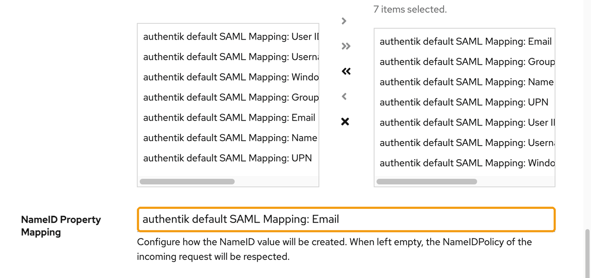
   <em>The seven default mappings are pre-selected; NameID must be changed to the Email mapping. (Source: p. 12, Figure 3.13)</em>

<strong>Supporting screenshots (4):</strong> provider name and flow, ACS URL and Audience, assertion signing, Issuer override and Post binding

  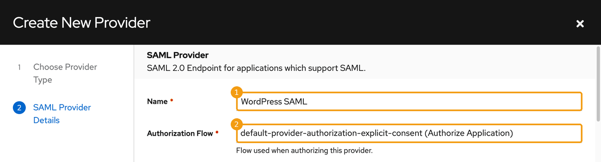
   <em>Provider name and explicit-consent authorization flow, which produces the Continue screen during testing. (Source: p. 11, Figure 3.9)</em>

  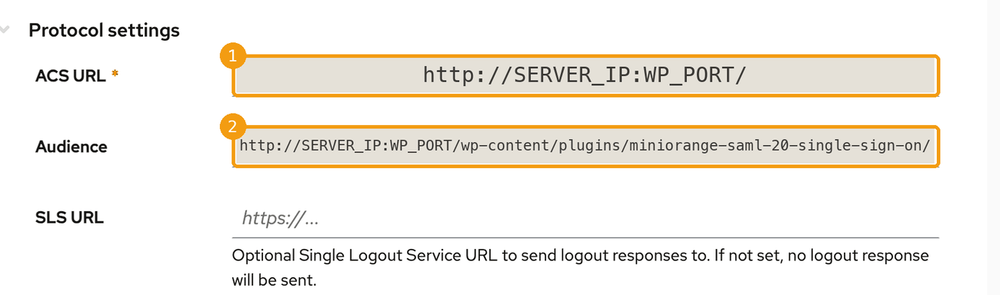
   <em>ACS URL is where Authentik posts the assertion; Audience is the SP Entity ID, so WordPress knows the assertion was meant for it. (Source: p. 11, Figure 3.10)</em>

  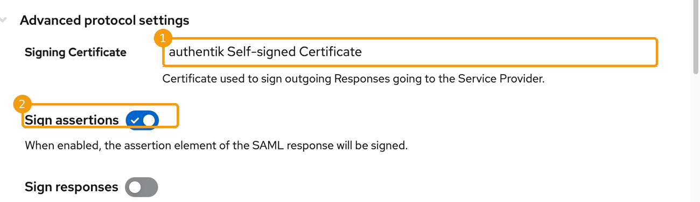
   <em>Authentik signs the assertion using the associated private key; WordPress verifies the signature using the public key in the certificate. (Source: p. 12, Figure 3.12)</em>

  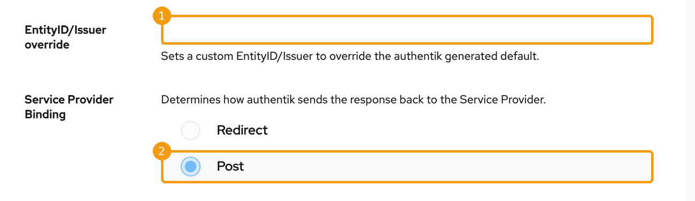
   <em>The Issuer override stays empty so Authentik uses its own Entity ID; Post binding is pre-selected. (Source: p. 12, Figure 3.14)</em>

### Step 4: Create and link the Authentik application

Under **Applications > Applications**, the **New Application** drop-down arrow is used to choose **with Existing Provider...**, then:

| Field | Value |
|---|---|
| Application name | `WordPress` |
| Slug | `wordpress` (Authentik suggests `word-press`; it is changed because the IdP URLs are built from the slug) |
| Provider | `WordPress SAML` |
| Launch URL | **Left blank** (under *UI settings*) |

**Why the Launch URL stays blank:** entering the WordPress address turns the portal tile into an ordinary link. The user then lands on WordPress signed out, no account is created and nothing reports an error, because no sign-in was attempted. Left blank, the tile points at the provider's SSO endpoint, which is what starts SSO. The guide calls this "the most convincing wrong answer in this lab."

**Checkpoint:** the Applications list shows *WordPress* with *WordPress SAML* in the Provider column. An empty Provider column means the two are not linked.

  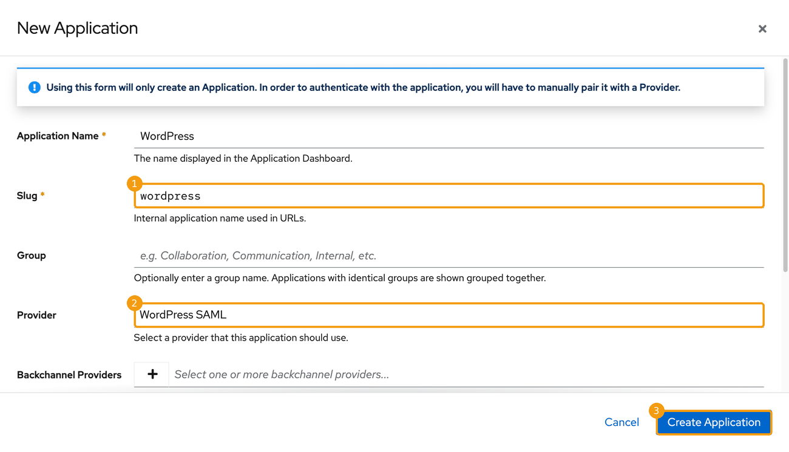
   <em>Slug corrected to wordpress and the provider selected before Create Application. (Source: p. 14, Figure 3.19)</em>

  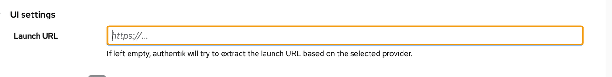
   <em>Launch URL left empty, which is what makes the tile start SSO. (Source: p. 15, Figure 3.20)</em>

<strong>Screenshot:</strong> checkpoint showing the application linked to its provider

  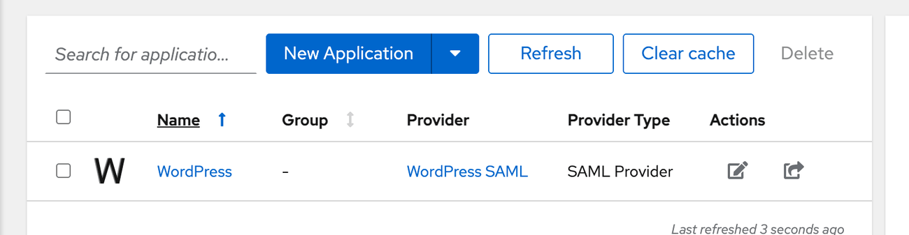
   <em>Checkpoint: the Provider column reads WordPress SAML. (Source: p. 16, Figure 3.21)</em>

### Step 5: Download the IdP metadata from Authentik

Once the application is linked, the **WordPress SAML** provider gains a **Metadata** tab. The metadata is downloaded as an XML file, which carries the SSO URL, the IdP Entity ID and the full X.509 signing certificate together. This avoids copying three values by hand and the risk of a clipped or mismatched certificate. The provider's Overview also lists these values for manual entry if needed. **Checkpoint:** the XML file shows `EntityDescriptor` near the top.

<strong>Screenshots (2):</strong> downloading the IdP metadata and the equivalent values for manual entry

  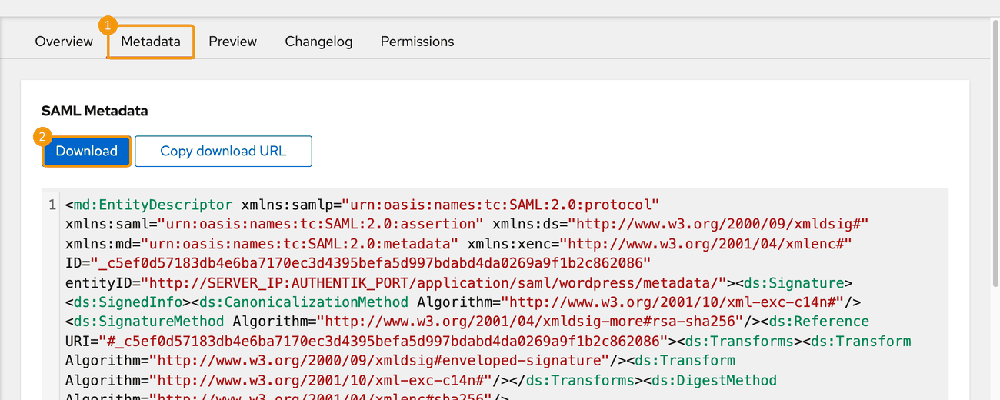
   <em>Downloading the IdP metadata file from the provider's Metadata tab. (Source: p. 18, Figure 3.24)</em>

  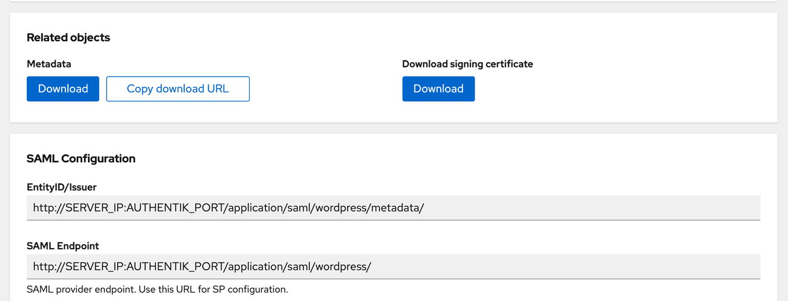
   <em>The same values for manual entry: the IdP Entity ID/Issuer and the SAML endpoint, both built from the application slug. (Source: p. 18, Figure 3.25)</em>

### Step 6: Import the IdP metadata into the WordPress plugin

In the plugin's **IDP Configuration** tab, Authentik is not in the provider grid, so **Custom IDP** is selected. Under **Upload IDP Metadata**, the IdP is named `Authentik` and the XML file from Step 5 is uploaded. The plugin fills in the **IdP Entity ID or Issuer**, **SAML Login URL** and **X.509 Certificate**, and shows *Identity Provider details saved successfully*.

**Checkpoint:** after reloading the IDP Configuration tab, all four values are still present. A blank field means the configuration did not save. The guide notes that the SAML Logout URL field is a premium feature in the free plugin.

  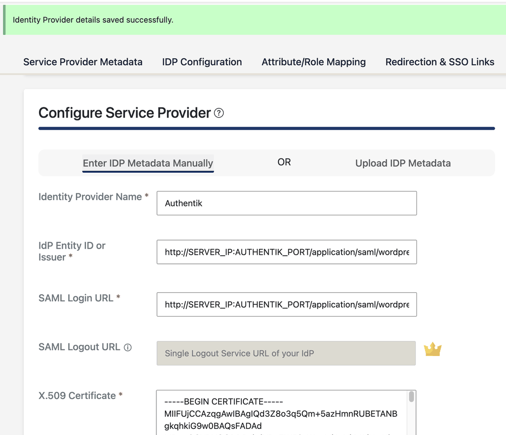
   <em>IdP details imported from the metadata file and saved. (Source: p. 21, Figure 3.30)</em>

<strong>Screenshot:</strong> selecting Custom IDP in the plugin

  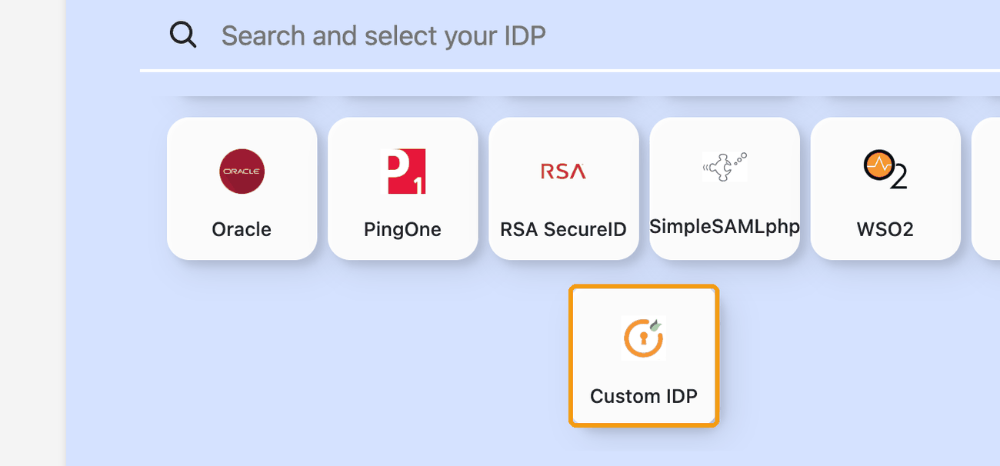
   <em>Custom IDP works with any SAML 2.0 identity provider, including Authentik. (Source: p. 20, Figure 3.27)</em>

### Step 7: Create the test user, bind access and preview the assertion

A test user is created in Authentik (**Directory > Users > New User > Internal User**) with username `wp.tester`, display name `WP Tester` and email `wp.tester@example.com`, and a password is then set separately, because the creation form has no password field: open the test user, then select **Recovery > Set password**. The email must be **unique in WordPress** and **under 60 characters**. If it matches an existing WordPress account such as the admin, the plugin signs in as that account and creates nothing.

The user is then bound to the application (**Applications > WordPress > Policy / Group / User Bindings > Create or bind... > Bind a user**). With no bindings, every Authentik user can open WordPress; once a binding exists, users it does not cover lose access. A group can be bound instead of an individual user.

Before testing, the provider's **Preview** tab is used to confirm that the NameID for the test user is the email address.

  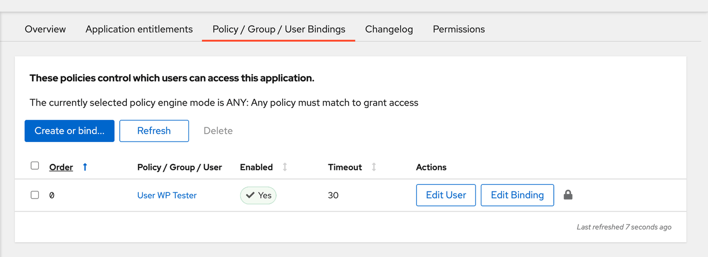
   <em>The test user binding; users it doesn't cover can no longer open WordPress. (Source: p. 25, Figure 3.41)</em>

<strong>Supporting screenshots (2):</strong> creating the test user and previewing the NameID

  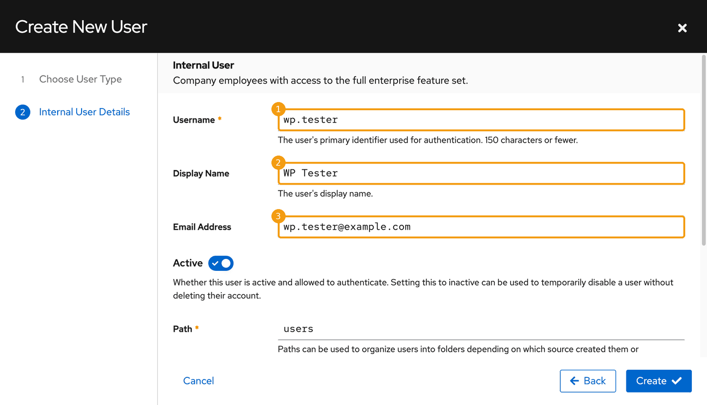
   <em>Creating the test user; the email becomes the WordPress username. (Source: p. 23, Figure 3.35)</em>

  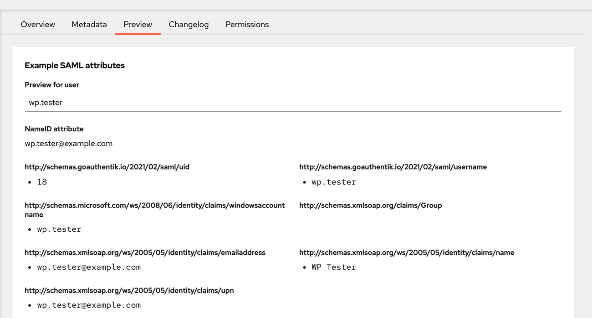
   <em>Assertion preview: the NameID attribute is the user's email. (Source: p. 26, Figure 3.42)</em>

### Step 8: Test SSO as the non-admin user

The tester signs out of WordPress, opens a **private/incognito window** (an existing admin session would mask a broken SSO flow) and signs in to the Authentik user portal **as the test user, not the admin**. MFA from Lab 2 still applies: a user with no authenticator is taken through TOTP enrollment during this sign-in. The tester clicks the **WordPress** tile and approves the explicit-consent screen. Finally, the WordPress **Users** page is checked in the normal admin browser session.

<strong>Supporting screenshots (3):</strong> test-user sign-in, portal tile and consent screen

  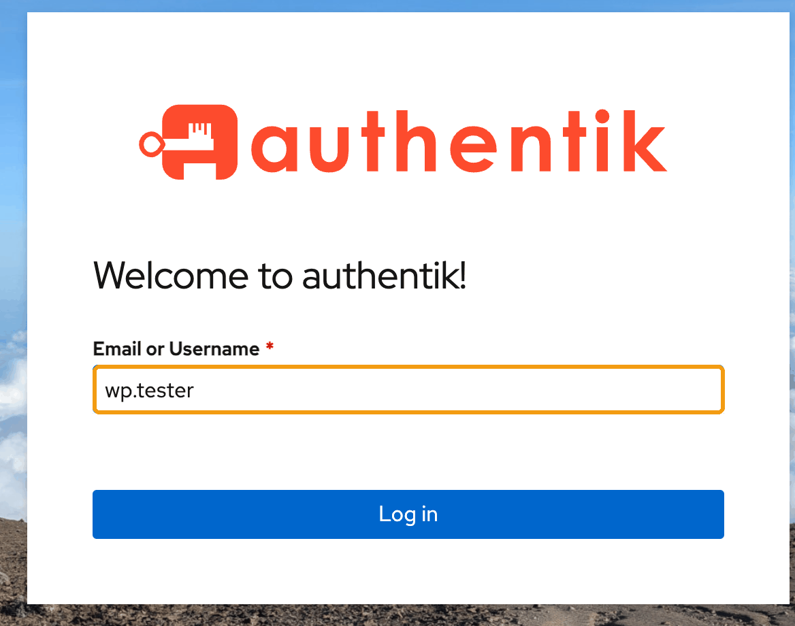
   <em>Signing in as the test user, not admin, to test what a normal user gets. (Source: p. 27, Figure 3.44)</em>

  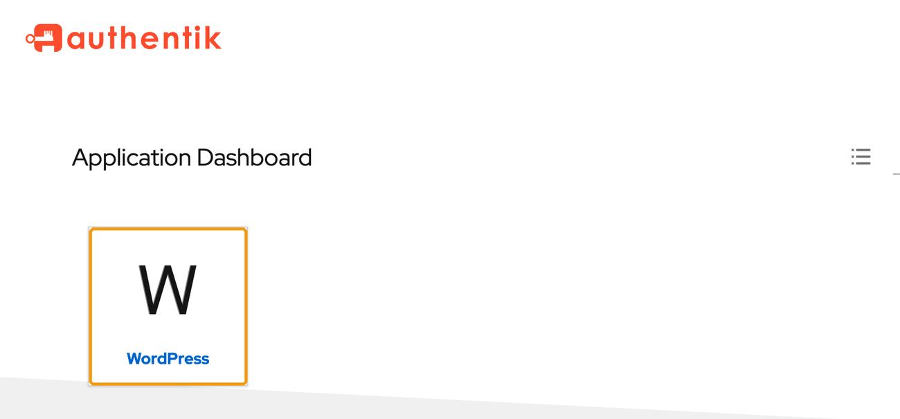
   <em>Clicking the tile starts SSO from the identity provider side. (Source: p. 28, Figure 3.46)</em>

  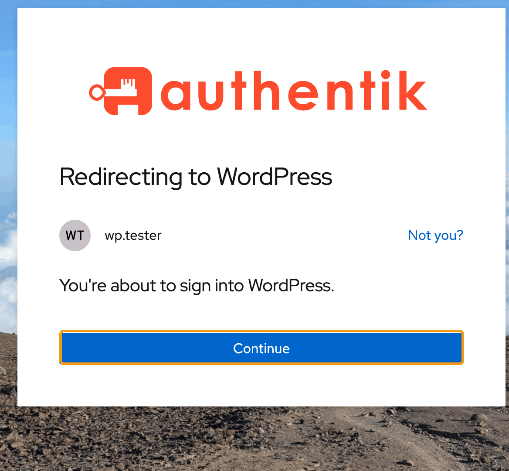
   <em>The explicit-consent flow asks before sending the user's identity to WordPress. (Source: p. 29, Figure 3.47)</em>

  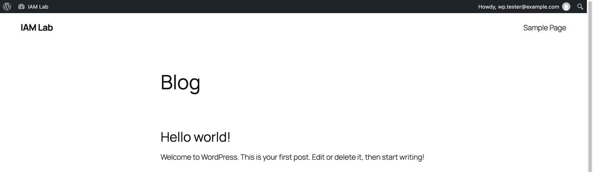
   <em>The user lands on the site already signed in; the toolbar shows the test user. (Source: p. 29, Figure 3.48)</em>

  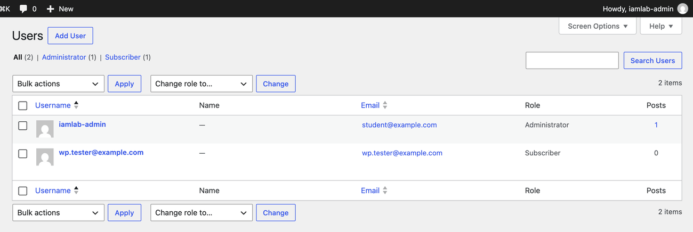
   <em>JIT provisioning: a WordPress account that did not exist before, with username and email both set to the email address. (Source: p. 29, Figure 3.49)</em>

### Optional configuration (not part of the core lab)

The guide lists these as optional extensions:

- **Group-based access control:** create groups in Authentik (for example *WordPress Users* and *Admins*), add users, and bind the group to the application so only members see the tile.
- **Custom attribute mapping:** extra attributes can be added to the provider's property mappings and inspected on the Preview tab. The free plugin cannot consume them; custom attributes and group-to-role mapping require a paid plan.
- **Manual metadata entry:** if the XML upload fails, the four IdP values can be typed into the plugin's *Enter IDP Metadata Manually* tab, including the certificate's BEGIN and END lines.

---

## :mag: Key Findings / Results

### Expected result (source-demonstrated)

One sign-in at Authentik and one click later, the test user is inside WordPress with an account that did not exist before: **SSO plus JIT provisioning**.

| Check from the guide's testing checklist | Source evidence |
|---|---|
| Clicking the WordPress tile signs the test user in to WordPress | Figures 3.46–3.48 |
| JIT provisioning creates the user in WordPress on first login | Figure 3.49 |
| WordPress username and email both match the Authentik user's email | Figures 3.42 and 3.49 |
| MFA from Lab 2 still applies during the SSO sign-in | Described in Step 8 (enrollment screenshot intentionally excluded) |

The free plugin keys every field off NameID, so the display name is also the email address. The guide notes this is expected, not a broken mapping.

### Technical findings

- **NameID mapping is required for this plugin.** A blank NameID mapping leads to `WPSAMLERR011` (username length limit exceeded). Setting it to the Email mapping resolves this.
- **A filled-in Launch URL breaks SSO silently.** The tile becomes a plain link and no sign-in is attempted, so there is no error to log.
- **Configuration order matters.** The plugin defines the SP values, and Authentik produces no metadata until the application is linked to the provider.
- **Access is open until a binding exists.** With no bindings, every Authentik user can open WordPress.
- **The plugin matches existing accounts by email.** A test user whose email matches an existing WordPress account (such as the admin) is signed in as that account, and no new account is created.
- **No single logout on the free plugin.** Authentik supports SAML single logout through the provider's SLS URL, but the free miniOrange plugin does not, so signing out of Authentik leaves the WordPress session open.

### Troubleshooting method

When the Authentik form reports a generic error, the guide's method is to open the browser developer tools (**F12 > Network**), find the failed `POST /api/v3/providers/saml/` request with a **400** status and read its **Response** tab, which names the exact field, for example `{"name": ["provider with this name already exists."]}`.

| Issue | What to check |
|---|---|
| Generic "An error occurred while creating the provider" | Read the API response; usually a hidden space in a pasted ACS URL or a duplicate provider name |
| ACS URL rejected as invalid | Clear the field and retype it; do not paste URLs from a PDF |
| Redirect or Destination mismatch at sign-in | The ACS URL must match the plugin exactly, including port and trailing slash |
| `WPSAMLERR011` after clicking the tile | Set NameID property mapping to Email; keep the user's email under 60 characters |
| Signature or certificate error | Re-download and re-upload the metadata; confirm the signing certificate; if needed, turn off *Character Encoding* on the IDP Configuration tab |
| User not created in WordPress | Check for an error code (e.g. `WPSAMLERR011`, `WPSAMLERR005`) and whether the email matches an existing account |
| Application tile not visible | The user is not covered by a binding, or the tile list is cached |
| Works for admin but not the test user | An existing admin session is masking the flow; test in a private window |

### Security considerations (lab vs. production)

The lab runs on plain HTTP by design. The guide's production recommendations are:

- Use **HTTPS**; SAML assertions travel through the browser and are readable in transit without it.
- **Rotate** signing certificates and client secrets on a schedule.
- **Bind applications to groups**; not every user needs every application.
- Set **session timeout** policies in each application, not just the IdP.
- **Monitor** Authentik *Events > Logs* for failed authentications.
- Keep Authentik and every integrated application **patched**.
- Use a **NameID that never changes** (or prevent email changes); if the NameID changes, the application may treat the same person as a new user.
- **Confirm single logout support** in every SP before telling users that one logout ends every session.
- Apply **least privilege**: access to the IdP is not access to everything behind it.

---

## :brain: Skills Demonstrated

- SAML 2.0 federation concepts: IdP/SP roles, ACS URL, Entity IDs, Audience and HTTP-POST binding
- Identity Provider administration in Authentik: providers, applications, flows and property mappings
- Metadata and X.509 signing certificate exchange between IdP and SP
- Just-in-time (JIT) user provisioning and account-matching behavior
- Application access control with policy, group and user bindings
- Keeping MFA enforced within an SSO flow
- Structured troubleshooting with browser developer tools and API error responses
- Distinguishing lab configuration from production-ready security controls

---

## :camera_with_flash: Screenshots & Evidence

Additional screens from the source guide that support the findings above. Expand each section to view them.

<strong>Configuration-order evidence:</strong> provider before the application exists

  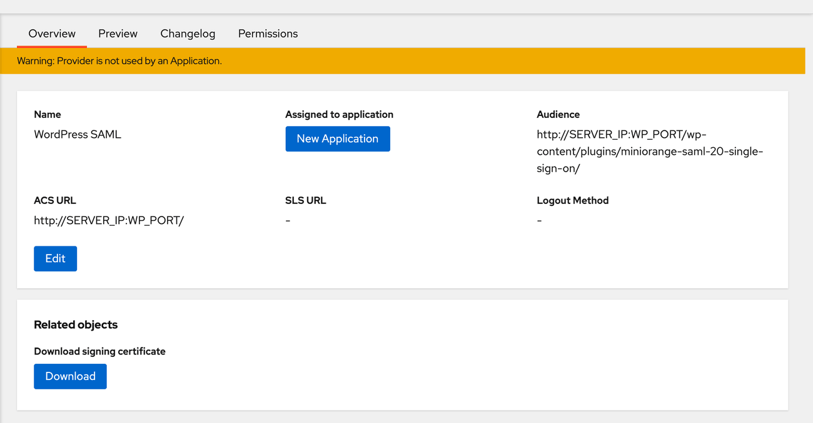
   <em>Before the application exists, the provider warns it isn't used and has no Metadata tab, which is why the application is created first. (Source: p. 16, Figure 3.22)</em>

<strong>Troubleshooting evidence (3):</strong> failed API request, API error response and WPSAMLERR011

  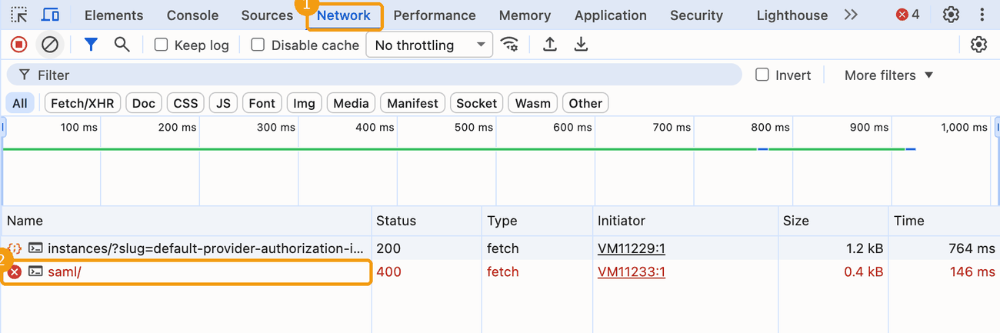
   <em>Developer tools Network tab: the failed Create is the red saml/ request with status 400. (Source: p. 31, Figure 3.50)</em>

  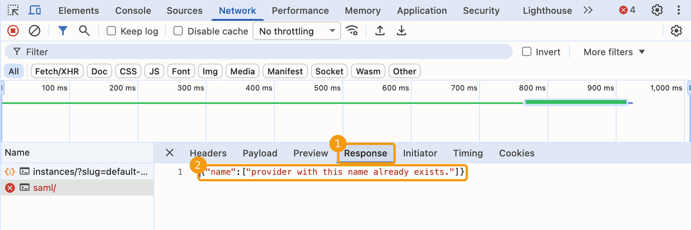
   <em>The Response tab names the exact field, here a duplicate provider name. (Source: p. 32, Figure 3.51)</em>

  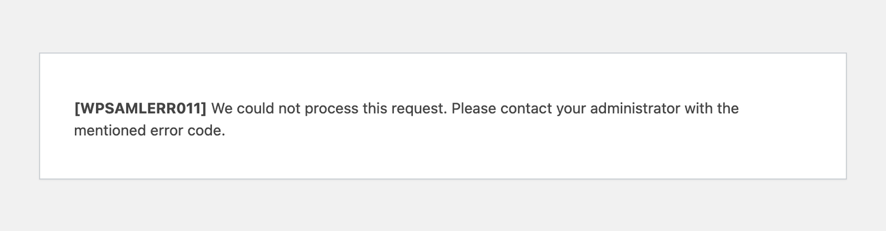
   <em>WPSAMLERR011: the NameID was too long for a WordPress username; the Email NameID mapping resolves it. (Source: p. 34, Figure 3.52)</em>

A full list of screenshots, source pages, figure numbers and redaction decisions is kept in [`docs/evidence-manifest.json`](docs/evidence-manifest.json).

---

## :briefcase: Real-World Relevance

- **Enterprise environments:** SAML remains a common way to connect business web applications to a central identity provider. The IdP/SP configuration, metadata exchange and identifier matching practiced here follow the same pattern used with other SAML 2.0 identity providers.
- **Identity and access management:** centralized authentication, automated account creation on first login and binding-based access control are core IAM tasks in onboarding and access governance.
- **IT operations:** JIT provisioning removes manual account setup, and reading the API response behind a generic error is a repeatable way to diagnose integration failures.
- **Cybersecurity operations:** signed assertions, MFA at the IdP, least-privilege bindings and awareness of single-logout gaps directly affect how much an account compromise can reach.

---

## :memo: Summary

This lab documents a SAML 2.0 Single Sign-On integration in which Authentik acts as the Identity Provider and WordPress as the Service Provider. The guide covers the full trust setup: reading version-specific SP values from the plugin, creating a signed SAML provider with an email-based NameID, linking an application with a blank Launch URL, exchanging IdP metadata, and restricting access with a user binding. The source-demonstrated outcome is a non-admin user signing in once at Authentik, with MFA still enforced, and landing in WordPress with an account created automatically by JIT provisioning.

The lab demonstrates practical IAM skills in federation, identity provider administration, access control and structured troubleshooting. It also documents the free plugin's limits and the gap between a plain-HTTP lab and a production deployment.

---

## :warning: Disclaimer

This project is documented for educational and portfolio purposes. The lab design, instructions and screenshots are from *Hands-On IAM Labs – Lab 3: Setting Up Single Sign-On* by Andrew, All Things Identity, and remain the property of their author. Environment addresses are shown as placeholders, and no passwords, secrets or MFA enrollment data are included.

---

  <strong>Created as part of a professional cybersecurity and IAM portfolio.</strong>

